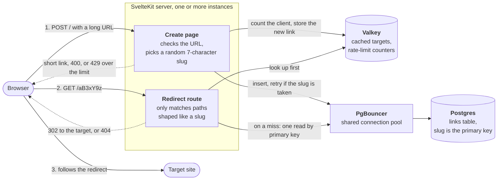

# url-shortener

Paste a long URL, get a short link. Opening the short link redirects to the
original URL.

Built with SvelteKit, Postgres and Drizzle, with Valkey for the redirect cache and the rate limit.

## Run it locally

You need Node 26 (`mise install` picks it up from `mise.toml`), pnpm and Docker.

```sh
pnpm install
cp .env.example .env
pnpm db:start     # Postgres, PgBouncer and Valkey in Docker
pnpm db:migrate   # create the tables
pnpm dev
```

Locally the app talks to Postgres through PgBouncer, the same way it does in
production, so pooler-only problems show up on your machine first.

| Service   | Address          | Used by                            |
| --------- | ---------------- | ---------------------------------- |
| PgBouncer | `localhost:6432` | The app (`DATABASE_URL`)           |
| Postgres  | `localhost:5433` | Migrations (`DATABASE_DIRECT_URL`) |
| Valkey    | `localhost:6379` | The app (`VALKEY_URL`)             |

## Commands

| Command            | What it does                                |
| ------------------ | ------------------------------------------- |
| `pnpm dev`         | Start the dev server                        |
| `pnpm test`        | Run the unit tests                          |
| `pnpm check`       | Type-check the project                      |
| `pnpm lint`        | Check formatting and lint                   |
| `pnpm build`       | Build for production                        |
| `node build`       | Run the production build                    |
| `pnpm db:generate` | Write a migration after changing the schema |
| `pnpm db:migrate`  | Apply pending migrations                    |

## System design



There are two paths through the app. Creating a link validates the URL, checks the client's rate limit, picks
a random slug and inserts a row. Opening a short link looks the slug up in
Valkey and falls back to a single read by primary key in Postgres, then answers
with a 302. It is the path that carries almost all the traffic, so it does
nothing else.

## How it works

- Links live in one `links` table, keyed by slug
  (`src/lib/server/db/schema.ts`). Schema changes go through the SQL
  migrations in `drizzle/`.
- A slug is 7 random base62 characters from the cryptographic generator, so
  links cannot be guessed or enumerated. A collision is rejected by the primary
  key and retried with a new slug.
- Targets are cached in Valkey for 24 hours, and a new link is cached as soon
  as it is created, so most clicks never reach Postgres. Valkey is optional at
  runtime: if it is down or slow, redirects read Postgres instead.
- Creating links is rate limited to 10 per minute and 100 per day for each
  client. A client is an IPv4 address or an IPv6 /64 prefix. The counters live
  in Valkey, so the limit holds across instances. If Valkey is down the limit
  is not enforced, so that creating links keeps working.
- When the primary database is down, redirects keep working from the cache
  and, when `DATABASE_READ_URL` is set, from the replicas. Only creating links
  fails, with a "try again" message.
- The redirect answers with a 302, so every visit reaches the server and a link
  can still be changed or removed later.

## Running several instances

`pnpm build` produces a plain Node server, started with `node build`. It keeps
nothing in memory between requests, so any number of copies can run behind a
load balancer. This repo does not ship deployment files; a deployment needs to
provide:

- **A load balancer** in front of the instances. Point its health check at
  `GET /health`. It returns 200 while the instance can serve some redirects
  (from the cache, a replica or the primary) and 503 only when it can serve
  none. Its body reports the primary, the replica and the cache separately,
  for monitoring.
- **A connection pooler**: PgBouncer in transaction mode, in its own container
  next to Postgres, with every instance pointed at it. One shared pooler is
  what caps the connections Postgres sees; a pooler per instance would not.
  The app does not use prepared statements, so transaction mode is safe.
- **Valkey** (or Redis), shared by all instances, with a memory cap and
  `allkeys-lru` eviction so it drops the least used links when full. It needs
  no persistence. `/health` does not check it, because an instance without
  Valkey still serves redirects.
- **Migrations as a separate step.** Run `pnpm db:migrate` once per release
  with `DATABASE_DIRECT_URL` pointing at Postgres itself, not the pooler. Instances never migrate
  on start.

Environment variables for each instance:

| Variable              | Purpose                                                                                              |
| --------------------- | ---------------------------------------------------------------------------------------------------- |
| `DATABASE_URL`        | Connection string, pointing at the pooler                                                            |
| `DATABASE_READ_URL`   | Optional. Connection string for reads, pointing at standby replicas. Unset, reads use `DATABASE_URL` |
| `DATABASE_DIRECT_URL` | Connection string of Postgres itself. Only migrations use it                                         |
| `DATABASE_POOL_MAX`   | Most connections one instance opens (default 10). Instances × this must fit the pooler               |
| `VALKEY_URL`          | Connection string of the shared Valkey, such as `redis://valkey:6379`                                |
| `PORT`                | Port to listen on (default 3000)                                                                     |
| `ORIGIN`              | Public URL of the app, such as `https://sho.rt`. Short links are built from it                       |
| `ADDRESS_HEADER`      | Header carrying the visitor's IP behind a proxy, such as `X-Forwarded-For`                           |
| `XFF_DEPTH`           | Number of trusted proxies in front of the app, when using `X-Forwarded-For`                          |

Set `ADDRESS_HEADER` whenever the app sits behind a proxy or load balancer.
Without it every visitor appears to come from the proxy's address and they all
share one rate limit. Do not set it when the app is reached directly, or
visitors could pick their own address by sending the header themselves.

On `SIGTERM` an instance stops accepting requests, finishes the ones in flight,
closes its database connections and exits, so instances can be replaced one at
a time without dropping requests.

## Not built yet

There is no sign-in, so links have no owner, and a link cannot be edited or
taken down once created. The rate limit slows abuse down but does not stop
someone who controls many IP addresses.
