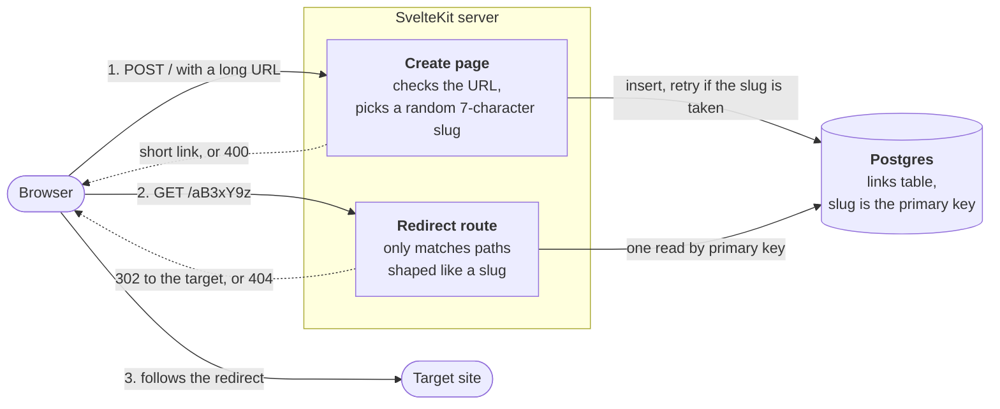

# url-shortener

Paste a long URL, get a short link. Opening the short link redirects to the
original URL.

Built with SvelteKit, Postgres and Drizzle.

## Run it locally

You need Node 26 (`mise install` picks it up from `mise.toml`), pnpm and Docker.

```sh
pnpm install
cp .env.example .env
pnpm db:start     # Postgres in Docker, on localhost:5433
pnpm db:migrate   # create the tables
pnpm dev
```

## Commands

| Command            | What it does                                |
| ------------------ | ------------------------------------------- |
| `pnpm dev`         | Start the dev server                        |
| `pnpm test`        | Run the unit tests                          |
| `pnpm check`       | Type-check the project                      |
| `pnpm lint`        | Check formatting and lint                   |
| `pnpm build`       | Build for production                        |
| `node build`       | Run the production build                    |
| `pnpm db:generate` | Write a migration after changing the schema |
| `pnpm db:migrate`  | Apply pending migrations                    |

## System design



There are two paths through the app. Creating a link validates the URL, picks
a random slug and inserts a row. Opening a short link is a single read by
primary key followed by a 302; it is the path that carries almost all the
traffic, so it does nothing else.

## How it works

- Links live in one `links` table, keyed by slug
  (`src/lib/server/db/schema.ts`). Schema changes go through the SQL
  migrations in `drizzle/`.
- A slug is 7 random base62 characters from the cryptographic generator, so
  links cannot be guessed or enumerated. A collision is rejected by the primary
  key and retried with a new slug.
- The redirect answers with a 302, so every visit reaches the server and a link
  can still be changed or removed later.

## Running several instances

`pnpm build` produces a plain Node server, started with `node build`. It keeps
nothing in memory between requests, so any number of copies can run behind a
load balancer. This repo does not ship deployment files; a deployment needs to
provide:

- **A load balancer** in front of the instances. Point its health check at
  `GET /health`, which returns 200 when the instance can reach the database and
  503 within two seconds when it cannot.
- **A connection pooler** such as PgBouncer in transaction mode between the
  instances and Postgres. The app does not use prepared statements, so
  transaction mode is safe.
- **Migrations as a separate step.** Run `pnpm db:migrate` once per release,
  against Postgres directly and not through the pooler. Instances never migrate
  on start.

Environment variables for each instance:

| Variable            | Purpose                                                                                |
| ------------------- | -------------------------------------------------------------------------------------- |
| `DATABASE_URL`      | Connection string, pointing at the pooler                                              |
| `DATABASE_POOL_MAX` | Most connections one instance opens (default 10). Instances × this must fit the pooler |
| `PORT`              | Port to listen on (default 3000)                                                       |
| `ORIGIN`            | Public URL of the app, such as `https://sho.rt`. Short links are built from it         |
| `ADDRESS_HEADER`    | Header carrying the visitor's IP behind a proxy, such as `X-Forwarded-For`             |
| `XFF_DEPTH`         | Number of trusted proxies in front of the app, when using `X-Forwarded-For`            |

On `SIGTERM` an instance stops accepting requests, finishes the ones in flight,
closes its database connections and exits, so instances can be replaced one at
a time without dropping requests.

## Not built yet

Anyone who can reach the app can create links: there is no sign-in and no rate
limit. Add one of them before deploying it somewhere public.
