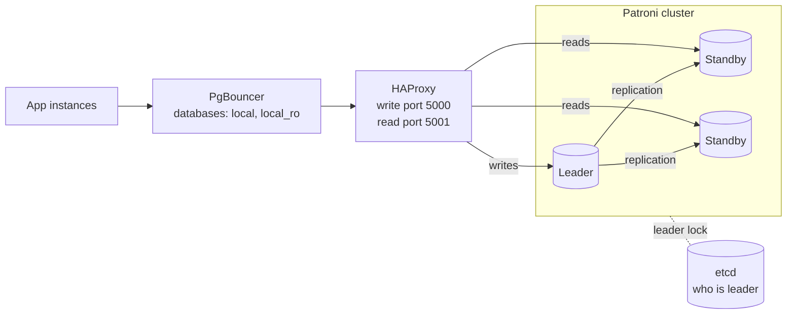

# Operating the database

How the database stays available, what the local setup reproduces, and what to
do when something fails.

## Topology



- **Patroni** runs on every Postgres node. The nodes compete for a leader lock
  in etcd; the holder is the leader and the others replicate from it. If the
  leader stops renewing the lock, a standby takes it and is promoted.
- **Replication is synchronous with a quorum of one.** A commit is confirmed
  only when at least one standby has it, so a link the app has acknowledged is
  never lost with the leader. Either standby can be down without stalling
  writes; with both down, Patroni falls back to unconfirmed commits so that
  writes continue.
- **HAProxy** asks each node's Patroni API whether it is leader or standby.
  The write port reaches the leader only. The read port reaches the standbys,
  or the leader when no standby is up.
- **PgBouncer** exposes two databases, `local` (writes) and `local_ro` (reads).
  The app's connection strings never change when the leader does.

## What the app does during a failure

| Failure               | Redirects                                   | Creating links                       |
| --------------------- | ------------------------------------------- | ------------------------------------ |
| Leader lost           | Keep working, from the cache and standbys   | 503 "try again" until a new leader   |
| One standby lost      | Keep working                                | Keep working                         |
| Both standbys lost    | Keep working, from the cache and the leader | Keep working, without confirmation   |
| Valkey lost           | Keep working, from the database             | Keep working, rate limit not applied |
| Everything but Valkey | Cached links only                           | 503                                  |

Measured locally, two app instances under a steady loop of creates and
uncached redirects:

| Event                   | Creating links unavailable | Failed redirects | Confirmed links lost |
| ----------------------- | -------------------------- | ---------------- | -------------------- |
| Leader container killed | 29 seconds                 | 0 of 616         | 0 of 424             |
| Planned switchover      | 4 seconds                  | 0 of 236         | 0                    |

The 29 seconds is Patroni's `ttl` of 30: the time a silent leader keeps its
lock. Lowering `ttl`, `loop_wait` and `retry_timeout` shortens it, at the cost
of failing over on shorter network hiccups.

## Commands

Locally, `pg1` can be any node:

```sh
pnpm db:status                      # who is leader, replication state and lag
docker compose exec pg1 patronictl -c /etc/patroni/patroni.yml switchover
docker compose exec pg1 patronictl -c /etc/patroni/patroni.yml edit-config
```

HAProxy's view of the nodes is at <http://localhost:7000>.

## Procedures

**The leader died.** Nothing to do first: a standby is promoted on its own.
Confirm with `pnpm db:status` that there is a leader and at least one standby
streaming. Then bring the old leader back; it rewinds itself and rejoins as a
standby. If it cannot rewind, wipe its data directory and let Patroni copy it
from the leader again (`patronictl reinit`).

**Planned maintenance on the leader.** Run a switchover to a standby first.
New links are unavailable for a few seconds; redirects are unaffected.

**Schema migration.** Run `pnpm db:migrate` with `DATABASE_DIRECT_URL` pointing
at the HAProxy write port, not at PgBouncer.

**Rehearse a failover locally.** `docker kill` the leader's container while
using the app, watch `pnpm db:status`, then `docker compose start` the node.

## What the local setup simplifies

Production must not copy these:

- **One etcd node.** Losing it locally freezes leader changes. Production needs
  three, on separate hosts.
- **One HAProxy and one PgBouncer.** Each is a single point of failure here.
  Run two of each behind a virtual IP or the platform's load balancer.
- **All nodes on one machine.** Put each Postgres node on its own host, ideally
  in separate zones.
- **Passwords in `compose.yaml`.** Use a secret store, and TLS between every
  component.
- **No backups yet.** Replication copies mistakes faithfully; it is not a
  backup.
